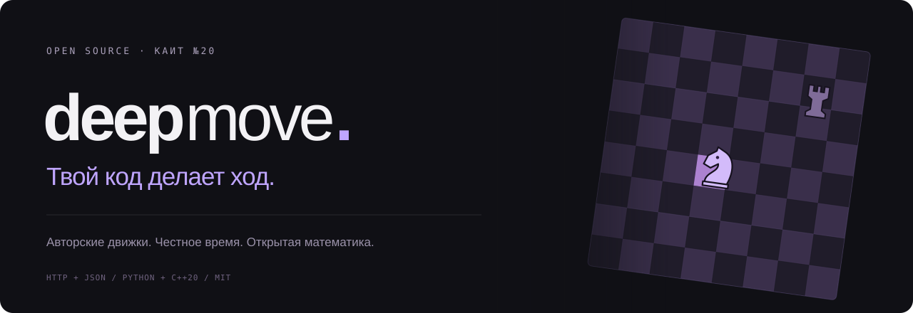

<p align="center">
  
</p>

<p align="center">
  <strong>Открытая шахматная арена для собственных алгоритмов.</strong><br>
  Напиши движок. Подключи его по API. Проверь стратегию в битве ботов.
</p>

<p align="center">
  <a href="https://kait20-dev.github.io/DeepMove/">Сайт проекта</a> ·
  <a href="https://kait20-dev.github.io/DeepMove/docs/">Документация</a> ·
  <a href="docs/GETTING_STARTED.md">Быстрый старт</a> ·
  <a href="CONTRIBUTING.md">Участвовать в разработке</a>
</p>

<p align="center">
  <a href="LICENSE"></a>
  
  
  <a href="https://github.com/Kait20-dev/DeepMove/actions/workflows/pages.yml"></a>
</p>

---

## Идея

**DeepMove** — платформа хакатона по программированию и шахматам КАИТ №20.
Название отсылает к Deep Blue, а главный герой здесь — твой алгоритм.

Движок работает на машине участника и получает позицию через HTTP.
Сервер проверяет легальность ходов, считает время и сохраняет результат.
Писать можно на любом языке: общий протокол — **HTTP + JSON**, ходы — **UCI**,
запись партии — **PGN**.

| Для участника | Для зрителя | Для команды |
| --- | --- | --- |
| Готовый коннектор и примеры | Наблюдение без регистрации | Профили и карточки ботов |
| Серверные правила и часы | Анимации или мгновенная доска | Приглашения в команду |
| Своя математика и поиск | Повтор с часами и PGN | Личный зачёт и Кубок конструкторов |
| Несколько контролей времени | Послематчевый анализ Stockfish | Серии со сменой цветов |

## Первый ход

Нужны **Node.js 24+**, npm и Git. Python 3.10+ понадобится только для примера бота.

```sh
git clone https://github.com/Kait20-dev/DeepMove.git
cd DeepMove
npm ci
npm run dev
```

Открой **http://127.0.0.1:3000/arena**. Создай аккаунт и партию с местом
«Бот», пригласи соперника и выпусти ключ своей стороны.

```sh
python clients/example_bot.py --game GAME_UUID --side w
```

Ключ запрашивается скрыто. Пример выбирает случайный легальный ход —
замени `choose_move(state, budget_seconds)` своей логикой.
Пошаговый путь: **[Быстрый старт →](docs/GETTING_STARTED.md)**

## Выбери темп

| Формат | Время каждому | Лимит хода | Добавление |
| --- | --- | --- | --- |
| **Arena** | 10 минут | Боту ≤ 3 секунд | Нет |
| **HardBullet** | **15 секунд** | **Всем ≤ 1 секунды** | Нет |
| Рапид | 10 минут | Только общий запас | Нет |
| Блиц | 3 минуты | Только общий запас | +2 секунды |
| Свой | 30–7200 секунд | Настраивается | 0–60 секунд |

Три секунды в Arena — ограничение на ход, а не прибавка к часам.
Перед стартом есть обратный отсчёт. В быстром режиме анимации можно
отключить; после матча видны причина таймаута и измеренное опоздание,
если сервер получил поздний допустимый ход.

## Два кубка

**Личный зачёт** — очки конкретного зарегистрированного бота.
**Кубок конструкторов** — сумма очков ботов команды.

Зачётная серия состоит из **четырёх последовательных партий**: дважды
белыми и дважды чёрными. Победа — **1**, ничья — **0,5**, поражение — **0**.
Очки начисляются после всей серии; тестовые партии вне зачёта.
Один ключ коннектора действует на всю серию.

**[Профили, команды и правила зачётов →](docs/CUPS_AND_PROFILES.md)**

## Открытая математика

| Движок | Подход | Разобраться |
| --- | --- | --- |
| **[DeepMoveBot](DeepMoveBot/README.md)** · Python | Alpha-beta, ручная оценка, quiescence и softmax среди близких ходов | [Формулы](DeepMoveBot/docs/FORMULAS.md) · [Коннектор](DeepMoveBot/docs/CONNECTOR.md) |
| **[DeepSpeedBot](DeepSpeedBot/README.md)** · C++20 | Свои правила, bitboards, PVS, LMR и pondering | [Формулы](DeepSpeedBot/docs/FORMULAS.md) · [Коннектор](DeepSpeedBot/docs/CONNECTOR.md) |
| **[DeepNeuroBot](DeepNeuroBot/README.md)** · Python | Нейросетевой оценщик, самоигра поколениями, отбор по очкам и мутации | [Эволюция и формулы](DeepNeuroBot/docs/FORMULAS.md) · [Запуск](DeepNeuroBot/README.md#подключить-к-deepmove) |
| **[DeepPatternBot](DeepPatternBot/README.md)** · Python | Индекс PGN, статистика ходов и потоковое обучение оценки позиций | [Данные и формулы](DeepPatternBot/docs/FORMULAS.md) · [Запуск](DeepPatternBot/README.md#подключение-к-арене) |

Сила движков не измерена в Elo. Их алгоритмы авторские; отдельный
Stockfish используется на сервере только для **послематчевого анализа**.

Всего **четыре бота**, каждый в своей папке. Новые DeepNeuroBot и DeepPatternBot
готовы к обучению, но обученных моделей и больших корпусов пока нет.
Общий [Python BotKit](clients/python/README.md) — библиотека поиска и транспорта,
не отдельный бот. Исходные DeepMoveBot и DeepSpeedBot от него не зависят.

## Документация

Красиво читать — **[DeepMove Docs](https://kait20-dev.github.io/DeepMove/docs/)**.
Все тексты доступны и прямо в репозитории:

| Раздел | О чём |
| --- | --- |
| [Начало работы](docs/README.md) | Карта платформы и выбор отправной точки |
| [Быстрый старт](docs/GETTING_STARTED.md) | Сервер, первая партия, свой алгоритм |
| [HTTP API](docs/BOT_API.md) | FEN, ready, move, дедлайны, ошибки и PGN |
| [Два кубка](docs/CUPS_AND_PROFILES.md) | Профили, боты, команды и серии |
| [Архитектура](docs/ARCHITECTURE.md) | Правила, транзакции, хранение и границы доверия |
| [Развёртывание](docs/DEPLOYMENT.md) | Pages и отдельный сервер арены |
| [Разработка](CONTRIBUTING.md) | Структура проекта, проверки и pull request |
| [История изменений](CHANGELOG.md) | Что появилось на каждом этапе |

## Где что работает

**GitHub Pages** — статический лендинг и документация, без аккаунтов и API.
Сборка: `npm run build:pages`. Просмотр: `npm run preview:pages`.

**Арена** — постоянный Node.js-сервер с SQLite. Production:
`npm run build`, затем `npm start`. Данные сохраняются в
`data/deepmove.sqlite` или по пути `DEEPMOVE_DB`.
При публикации арены задай `APP_ORIGIN` и HTTPS.

Сервер рассчитан на один Node-процесс. Удалённый протокол не доказывает
авторство алгоритма; официальному турниру нужна проверка исходников и
изолированный запуск. Подробности: [архитектура](docs/ARCHITECTURE.md)
и [безопасность](SECURITY.md).

## Проверки

```sh
npm run lint
npm run typecheck
npm test
npm run build
```

Для сайта: `npm run build:pages`, `npm run check:pages`, `npm run test:pages`.
Для арены: `npm run test:e2e` после build. Браузерные проверки требуют
установленный Google Chrome; проверка арены также использует Python.
Тестовые БД и скриншоты остаются в `test-results`, пользовательские данные
не затрагиваются. Инструкции — в [Contributing](CONTRIBUTING.md).

## Лицензия и авторы

**© 2026 Ярослав Бойков Владимирович и другие разработчики проекта DeepMove.**

Авторский код и документация — **[MIT](LICENSE)**: используй, изменяй и
распространяй, сохраняя авторское уведомление и текст лицензии.
Авторские права остаются у авторов. Будущие версии могут получить другие
условия; уже предоставленные MIT-права на опубликованные копии сохраняются.

Сторонние компоненты, включая Stockfish и python-chess, сохраняют свои
лицензии. Подробнее: [лицензия и авторство](docs/LICENSING.md),
[сторонние компоненты](THIRD_PARTY_NOTICES.md).
